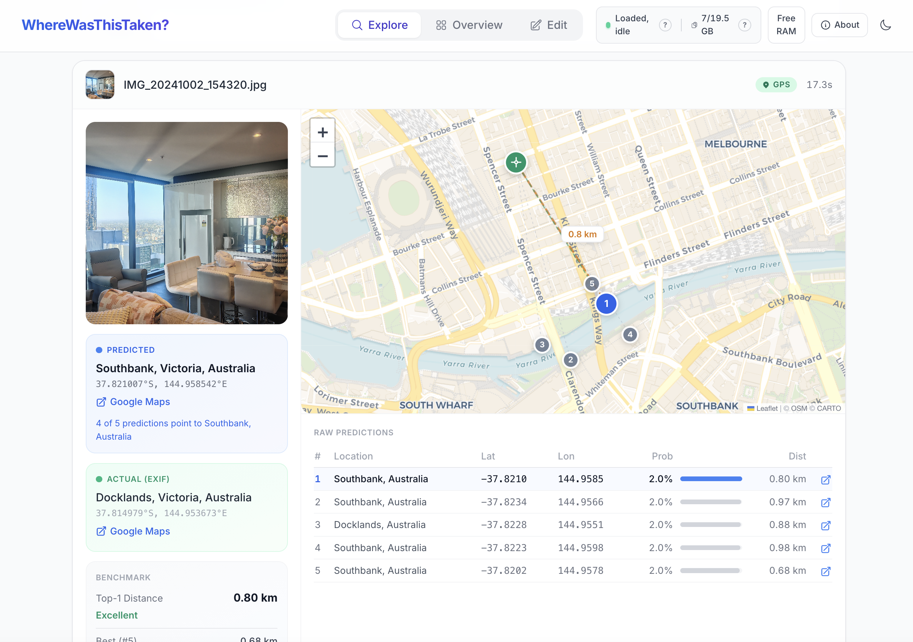
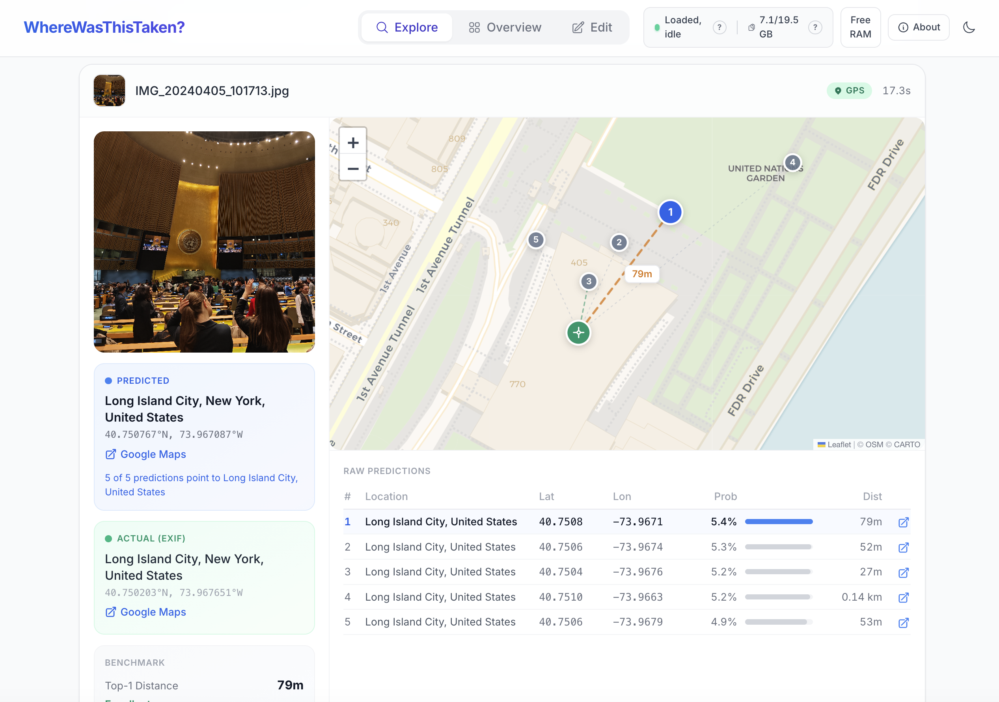
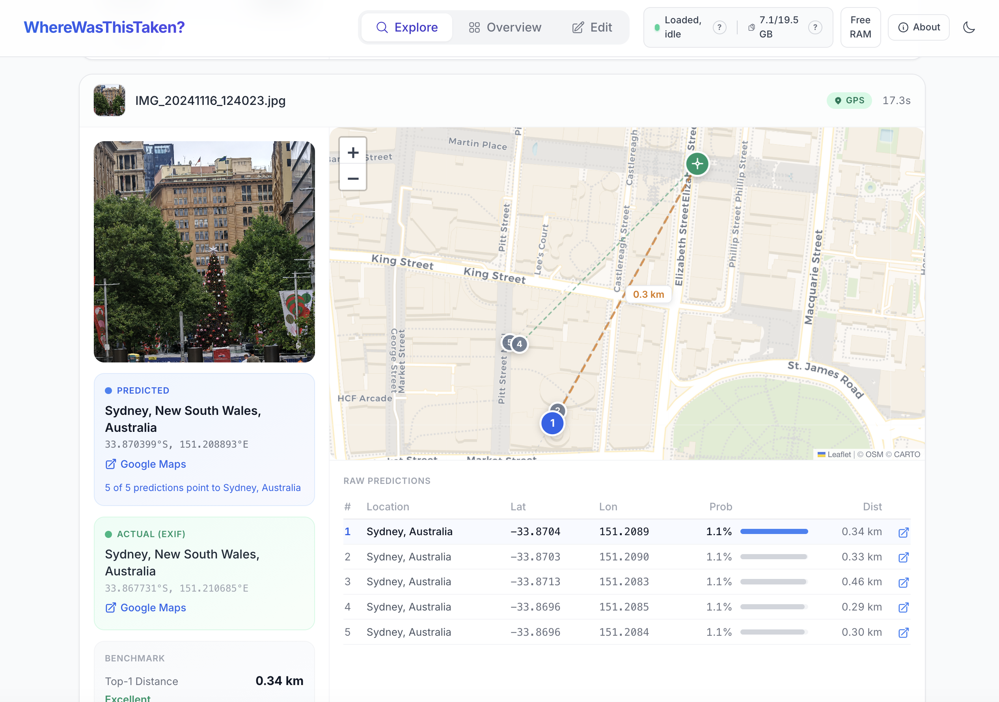
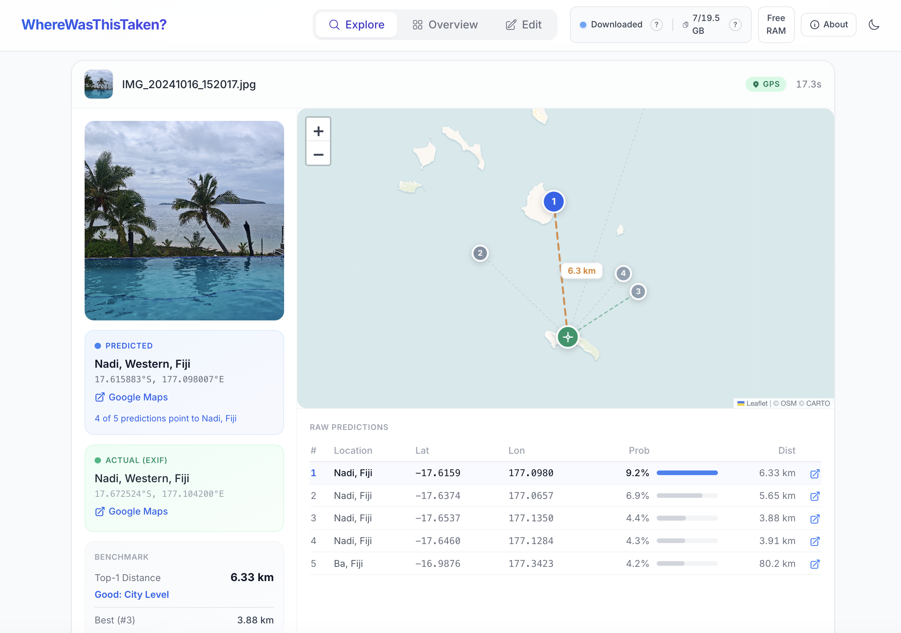
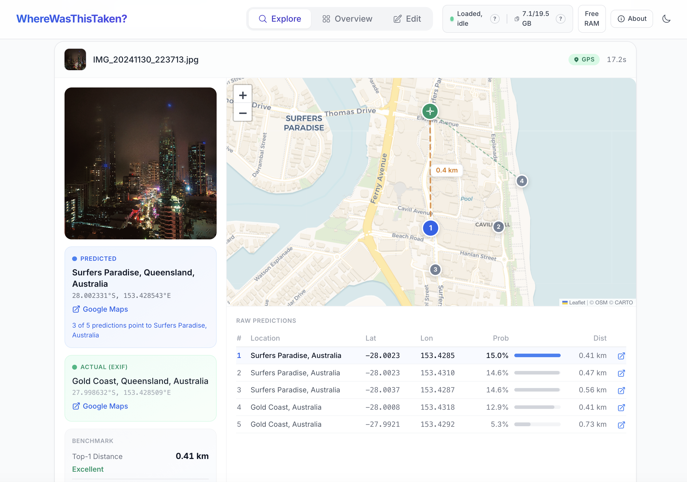
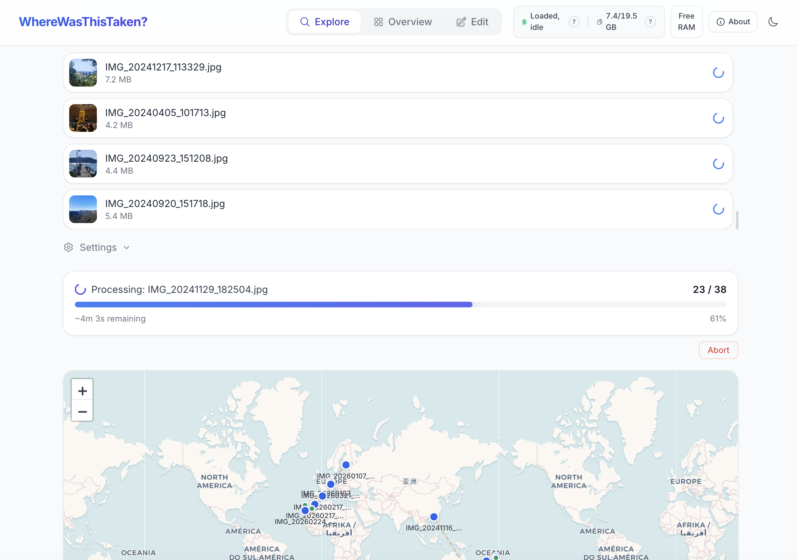
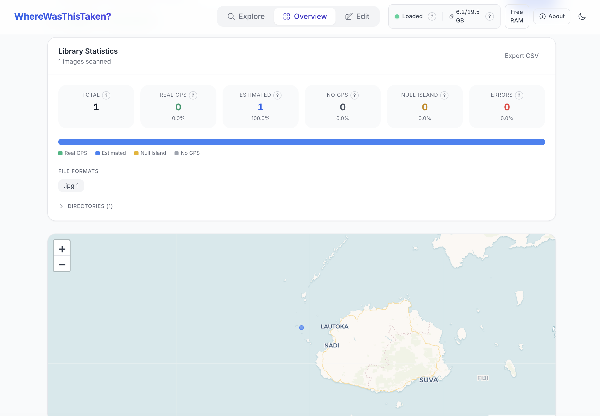
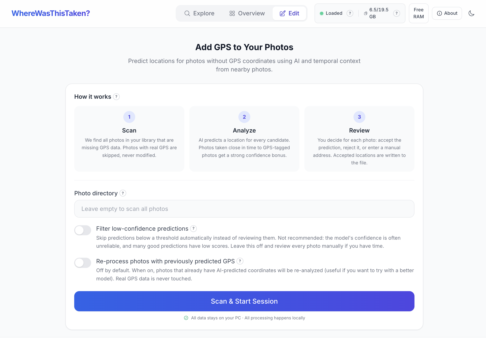
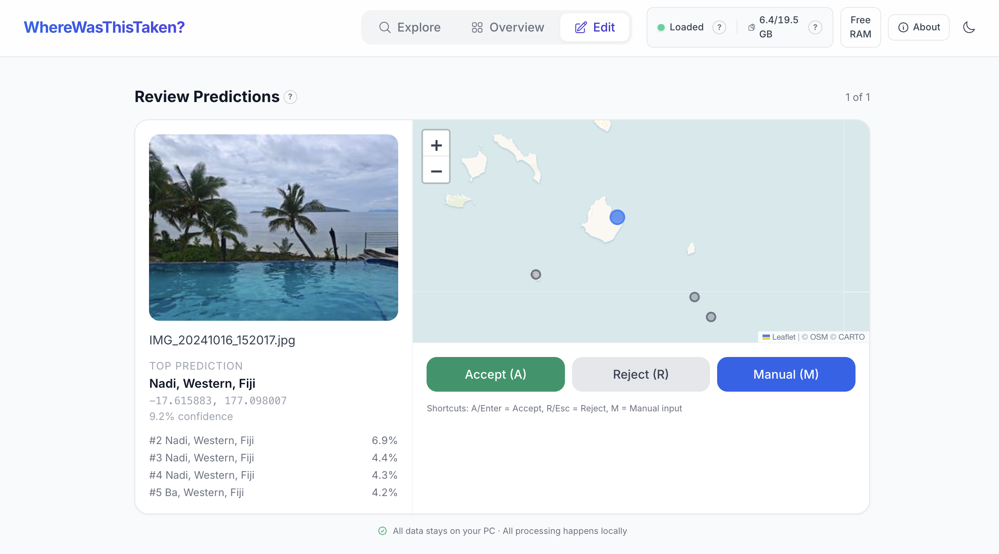

<div align="center">

# WhereWasThisTaken?

### Hi! This is a little tool that figures out where any photo was taken, running entirely on your own computer.

<p>
  
  
  
  
  
</p>

No uploads, no accounts, no telemetry. Just you, your photos, and a neural network that is surprisingly good at guessing where they were taken.

</div>

---

## Contents

1. [What this is](#what-this-is)
2. [The three modes](#the-three-modes)
3. [Privacy](#privacy)
4. [**▶ Quick start**](#quick-start)
5. [Configuration](#configuration)
6. [Under the hood](#under-the-hood)
7. [Contributing](#contributing)
8. [License and credits](#license)

---

## What this is

Almost everyone has a folder somewhere full of photos without location data. Scanned film. Screenshots. WhatsApp downloads. Phones with location turned off. They all land in your library and look a bit sad on any map view.

This tool gives them their place back. You drop a photo in and a deep learning model called GeoCLIP guesses where it was taken, usually accurately enough to recognize the exact neighborhood. You can run it on one photo, on a small batch, or on your entire library. It runs locally on your own machine. The model downloads once on first launch, after that you can unplug the internet and it still works.

---

## The three modes

| Mode                  | What you do                                                        | When to use it                                                               |
| --------------------- | ------------------------------------------------------------------ | ---------------------------------------------------------------------------- |
| [Explore](#explore)   | Drop in photos, read the predictions.                              | You are curious about a photo or a small batch.                              |
| [Overview](#overview) | Point at a folder, see what has GPS and what does not.             | You want to understand your library before editing anything.                 |
| [Edit](#edit)         | Let the AI fill in missing coordinates. You just accept or reject. | You want to enrich a pile of photos so they show up on your photo app's map. |

---

## Explore

Drop any photo into the upload zone and you get a world map with the AI's top five guesses, the top pick's address, and a distance-to-truth benchmark if the photo already had GPS.

<p align="center">
  
</p>

> Floor-to-ceiling windows, a dining table, no obvious landmark. The AI predicted **Southbank, Victoria**. The truth was **Docklands, Victoria**, about 800 metres away.

<p align="center">
  
</p>

> All five top predictions landed on **Long Island City, New York**. Off by **79 metres**. Essentially perfect.

<p align="center">
  
</p>

> Predicted **Sydney, NSW**. Off by **340 metres**.

<p align="center">
  
</p>

> Palms, turquoise water, no street signs. Predicted **Nadi, Western, Fiji**. Off by about **6 kilometres**, still in the right area.

<p align="center">
  
</p>

> Predicted **Surfers Paradise, Queensland**. Truth **Gold Coast, Queensland**. Off by **410 metres**. Night shots work too.

Up to 50 photos at once. The map populates live as each one finishes.

<p align="center">
  
</p>

> A batch of 38 photos being processed. 23 done, about 4 minutes remaining, and the results drop onto the world map as they arrive.

---

## Overview

Point it at a folder. Every image is sorted into `Real GPS`, `Estimated GPS` (coordinates written by this tool earlier), `No GPS`, `Null Island` (the classic (0, 0) bug), or `Errors`. Coordinates appear on a world map so the gaps are easy to spot.

<p align="center">
  
</p>

> A tiny example library with one photo. At the scale of a real camera roll this becomes a dense heat map of where you have been and where the GPS holes are.

Read-only. Nothing is modified. A natural first step before running the Edit mode.

---

## Edit

The main feature. A guided flow for filling in missing GPS coordinates. The AI does the heavy lifting, you click accept or reject on its suggestions. You never have to type an address unless you want to override a prediction.

**Step 1.** Pick a directory, tweak a couple of optional toggles, press Scan.

<p align="center">
  
</p>

> Configuration screen. Directory path, optional confidence filter, optional re-processing of previously predicted photos. The safety guarantee at the bottom is not decoration: real camera GPS is actually never touched.

**Step 2.** The model runs through every candidate photo. Photos taken close in time to GPS-tagged photos get a confidence bonus, because people cannot teleport.

**Step 3.** Review each suggestion, one photo at a time. `A` or `Enter` to accept, `R` or `Esc` to reject, `M` for a manual address.

<p align="center">
  
</p>

> One photo at a time. The AI shows its top pick plus four alternatives, three big buttons drive the decision, and the privacy reminder at the bottom makes the guarantee explicit.

Accepted coordinates go straight into the photo's EXIF, tagged `ESTIMATED` so you can always tell real GPS from predicted GPS later. A hundred photos take about ten minutes.

Real GPS from your camera is never touched.

---

## Privacy

Everything happens on your machine.

- Photos are read from your disk, processed in your RAM, written back to your disk. Nothing else.
- No telemetry, no analytics, no accounts.
- One network call on first launch to download the model weights from HuggingFace. After that, works offline. Reverse geocoding (coordinates to place names) and forward geocoding (address lookup) use external services when available but are optional.
- Every coordinate written by this tool is tagged `ESTIMATED:GEOCLIP:<version>:<timestamp>` in the photo's EXIF so real GPS and predicted GPS are always distinguishable.

---

## Quick start

You need Docker Engine 24+ and Docker Compose v2. Works on Linux, macOS, and Windows via WSL2. Roughly 4 GB of free disk for the model and 4 GB of free RAM while it is loaded.

```bash
git clone https://github.com/M-Enzinger/where-was-this-taken.git
cd where-was-this-taken
cp .env.example .env
docker compose up
```

Then open [http://localhost:8085](http://localhost:8085) in your browser.

On the very first launch the backend downloads the model weights (around 3.5 GB). You see it happen in the terminal. The frontend is held back until the backend reports ready, so `localhost:8085` does not respond until everything is in place. That is deliberate and avoids a half-loaded UI racing the download.

Subsequent starts are instant, the weights live in a named Docker volume.

To stop:

```bash
docker compose down       # keeps the model cache
docker compose down -v    # wipes the model cache too
```

### Pointing it at your own library

The repo ships with **no photos**. On first `docker compose up` an empty `./photos/` folder is created next to the project and mounted into the backend as `/photos`. Drop photos into that folder, or point the app at an existing library by setting the path in `.env`:

```ini
PHOTO_LIBRARY_PATH=/absolute/path/to/your/photos
```

Nothing leaves your machine. Only Edit mode ever writes to the files in this folder, and only under the safety guarantees described below.

---

## Configuration

All settings live in `.env`. Defaults ship in `.env.example`.

| Variable             | Default    | What it does                                                             |
| -------------------- | ---------- | ------------------------------------------------------------------------ |
| `PORT`               | `8085`     | Host port the UI is served on.                                           |
| `PHOTO_LIBRARY_PATH` | `./photos` | Host path mounted at `/photos` in the backend.                           |
| `GEOCLIP_TOP_K`      | `5`        | Number of ranked predictions returned per image.                         |
| `EDIT_MODE_ENABLED`  | `true`     | Guard for GPS-writing endpoints. Set `false` for a read-only deployment. |
| `MODEL_IDLE_TIMEOUT` | `600`      | Reserved. Idle auto-unload is wired but disabled.                        |

---

## Under the hood

This section is for the curious and for contributors. If you just want to use the app, you can stop reading here.

### Architecture

```
┌─────────────────────┐         ┌───────────────────────────────┐
│   React + Vite SPA  │  HTTP   │  FastAPI + Uvicorn            │
│   (frontend:8085)   │ ──────▶ │  GeoCLIP (PyTorch, CPU/GPU)   │
│                     │  /api   │  exiftool (Perl, GPS I/O)     │
│  framer-motion      │         │  reverse-geocoder (offline)   │
│  react-leaflet      │         │  OpenStreetMap tiles (CARTO)  │
└─────────────────────┘         └───────────────────────────────┘
        ▲                                  │
        │ blocked until                    │ mount
        │ backend is healthy               ▼
        │                       ┌──────────────────┐
        └───────────────────────│ host filesystem  │
                                │ /photos library  │
                                └──────────────────┘
```

Two docker services, one named volume for the model cache, one healthcheck that blocks the frontend until the backend has the model in RAM.

### How the AI works

GeoCLIP ([paper and code](https://github.com/VicenteVivan/geo-clip)) is a dual-encoder neural network. One encoder turns an image into a feature vector, a second encoder does the same for latitude/longitude coordinates. At inference the image is matched against a grid of candidate coordinates and the best matches are returned. It was trained on a large dataset of geotagged photos.

On its own it is roughly city-level accurate. Two extra signals tighten that up inside Edit mode:

1. **Temporal proximity.** For a photo without GPS, photos taken within minutes that do have GPS are strong evidence. A match within five minutes can override the raw model output, because people cannot physically teleport.
2. **Filename sequence and folder names.** Burst sequences, folder names like `Paris 2024`, and GPS-before-and-after ranges all contribute additional hints.

The combined confidence score is `max(model_confidence, temporal_confidence)`. Full logic in `backend/app/enhancer.py` and `backend/app/library_context.py`.

### Safety model for GPS writes

Three independent defences before any file is touched.

1. **Queue filter.** Only images the scanner reports as GPS-less enter the write queue in the first place.
2. **Pre-write double-check.** Right before calling `exiftool`, the file is re-read with both `exiftool` and Pillow. A disagreement or a detected GPS tag aborts the write.
3. **Post-write validation.** The file is re-read after writing and coordinates must match within floating-point tolerance, otherwise the write is considered failed.

### API reference

Everything is under `/api`.

| Method | Path                                                        | Purpose                                           |
| ------ | ----------------------------------------------------------- | ------------------------------------------------- |
| `GET`  | `/api/health`                                               | Liveness probe. Returns `{status, model_loaded}`. |
| `GET`  | `/api/system-status`                                        | Process RAM, total RAM, model state.              |
| `POST` | `/api/predict`                                              | Single-image prediction.                          |
| `POST` | `/api/predict/batch`                                        | Up to 50 files at once.                           |
| `POST` | `/api/scan`                                                 | Kick off an Overview-mode directory scan.         |
| `GET`  | `/api/scan/{id}/status`                                     | Scan progress polling.                            |
| `GET`  | `/api/scan/{id}/results`                                    | Full scan results.                                |
| `POST` | `/api/edit/start`                                           | Create an edit session.                           |
| `POST` | `/api/edit/{id}/round`                                      | Run prediction over candidate images.             |
| `GET`  | `/api/edit/{id}/queue/next`                                 | Fetch the next image awaiting review.             |
| `POST` | `/api/edit/{id}/review/{image_id}/{accept\|reject\|manual}` | Record a review decision.                         |
| `POST` | `/api/edit/{id}/apply/{image_id}`                           | Write the approved GPS to disk.                   |

### Code layout

```
.
├── backend/
│   ├── app/
│   │   ├── main.py              FastAPI app, single-image endpoints
│   │   ├── model.py             GeoCLIP lifecycle
│   │   ├── enhancer.py          Combined scoring
│   │   ├── library_context.py   Temporal, sequence, folder hints
│   │   ├── routes_scan.py       Overview mode API
│   │   ├── routes_edit.py       Edit mode API
│   │   ├── edit_session.py      Session state machine
│   │   ├── gps_detect.py        Bulletproof GPS reader
│   │   ├── gps_writer.py        Safe GPS writer
│   │   └── ...
│   └── Dockerfile
├── frontend/
│   ├── src/
│   │   ├── App.tsx              Shell, header, dark mode
│   │   ├── api.ts               Typed API client
│   │   └── components/          Explore, Overview, Edit, shared UI
│   └── Dockerfile
├── docker-compose.yml
├── .env.example
├── LICENSE
└── README.md
```

---

## Contributing

I wrote this for myself and put it online because other people probably have the same pile of GPS-less photos as me. If you find a bug, open an issue. If you have an idea for a feature, open an issue. If you ship a fix, open a pull request. All of those are welcome and I will try to respond quickly.

If you just want to say thanks, a GitHub star genuinely means a lot to a solo project.

## License

**GNU Affero General Public License v3.0.** See [LICENSE](LICENSE) for the full text.

In plain terms, AGPL-3.0 means you can use, modify, and redistribute this software for any purpose including commercial ones. The one catch is that if you modify it and run your modified version on a public server, you must release your modifications under the same license.

## Acknowledgements

This project stands on a tall stack of open-source giants. The About panel inside the app lists every dependency with its license and a link. Short version:

[**GeoCLIP**](https://github.com/VicenteVivan/geo-clip) by Vicente Vivanco Cepeda and coauthors (the model),
[**OpenAI CLIP**](https://github.com/openai/CLIP),
[**PyTorch**](https://pytorch.org),
[**Transformers**](https://huggingface.co/docs/transformers),
[**FastAPI**](https://fastapi.tiangolo.com),
[**Uvicorn**](https://www.uvicorn.org),
[**Pillow**](https://python-pillow.org),
[**exiftool**](https://exiftool.org),
[**React**](https://react.dev),
[**Vite**](https://vite.dev),
[**Tailwind CSS**](https://tailwindcss.com),
[**Framer Motion**](https://www.framer.com/motion),
[**Leaflet**](https://leafletjs.com),
[**React-Leaflet**](https://react-leaflet.js.org),
[**OpenStreetMap**](https://www.openstreetmap.org/copyright),
[**CARTO**](https://carto.com/attributions),
[**reverse_geocoder**](https://github.com/thampiman/reverse-geocoder),
[**geopy**](https://github.com/geopy/geopy),
[**pycountry**](https://github.com/pycountry/pycountry).

Thanks to every maintainer and contributor of those projects.

---

<div align="center">

Built with care by **Maximilian Enzinger**.

</div>
